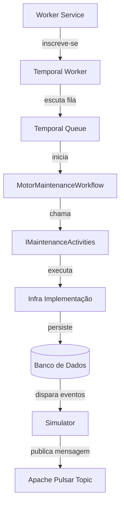

Viewed README.md:7-13
Viewed README.md:1-29


## 1️⃣ What the project does
- **Domain**: Manages motor‑telemetry data from a fleet of machines.
- **Workflow**: Uses **Temporal** to orchestrate a *Motor Maintenance* workflow that reacts to telemetry thresholds (e.g., vibration > 4.5 mm/s).
- **Messaging**: Publishes telemetry events to **Apache Pulsar** via the `DotPulsar` client.
- **Worker Service**: A .NET Worker (`Rm.FleetMonitoring.Worker`) runs a **Temporal worker** that listens on the queue `rm‑motor‑maintenance‑queue` and executes the workflow.

---

### 2️⃣ Repository layout (high‑level)

```
FleetMonitoring/
│
├─ src/
│   ├─ Rm.FleetMonitoring.Domain          # POCOs, enums, validation
│   ├─ Rm.FleetMonitoring.Application    # Use‑cases, interfaces, workflows
│   ├─ Rm.FleetMonitoring.Infrastructure # Temporal & Pulsar plumbing, DI
│   └─ Rm.FleetMonitoring.Worker         # .NET Worker hosting the Temporal worker
│
├─ Rm.FleetMonitoring.Simulator           # Tiny console app that sends demo telemetry
└─ README.md                              # This guide
```

---

### 3️⃣ Quick‑start: Build & run the whole solution

> ⚡ **All commands are executed from the repository root** (`/home/robertmendes/project/.net/FleetMonitoring`).

#### 3.1. Restore / build the solution
```bash
dotnet build
```
> This restores all NuGet packages (Temporalio, DotPulsar, etc.) and compiles every project.

#### 3.2. Run the **Temporal worker** (the core background service)
```bash
dotnet run --project src/Rm.FleetMonitoring.Worker/Rm.FleetMonitoring.Worker.csproj
```
You should see something like:

```
[TEMPORAL WORKER] Listening on queue 'rm-motor-maintenance-queue'...
```

The worker will stay alive, waiting for telemetry events.

#### 3.3. In a **second terminal**, start the **simulator** that publishes a test message:
```bash
dotnet run --project src/Rm.FleetMonitoring.Simulator/Rm.FleetMonitoring.Simulator.csproj
```
Sample output:

```
[SIMULADOR] Evento enviado! ID: 11:1:-1:-1:persistent://public/default/rm-motor-telemetry
```

The worker receives this event, triggers the `MotorMaintenanceWorkflow`, and executes the activities defined in `IMaintenanceActivities`.

---

### 4️⃣ Detailed command reference (the same steps you can find in the README)

| Step | Command | Explanation |
|------|---------|-------------|
| **Create solution & folders** | (already done) | `mkdir FleetMonitoring && cd FleetMonitoring` |
| **Create solution** | `dotnet new sln -n Rm.FleetMonitoring` | Generates `Rm.FleetMonitoring.sln`. |
| **Create project structure** |<br>`mkdir src && cd src`<br>`dotnet new classlib -n Rm.FleetMonitoring.Domain`<br>`dotnet new classlib -n Rm.FleetMonitoring.Application`<br>`dotnet new classlib -n Rm.FleetMonitoring.Infrastructure`<br>`dotnet new worker -n Rm.FleetMonitoring.Worker` | Generates the four key projects. |
| **Add projects to solution** | `cd ..`<br>`dotnet sln add src/Rm.FleetMonitoring.Domain/Rm.FleetMonitoring.Domain.csproj`<br>`dotnet sln add src/Rm.FleetMonitoring.Application/Rm.FleetMonitoring.Application.csproj`<br>`dotnet sln add src/Rm.FleetMonitoring.Infrastructure/Rm.FleetMonitoring.Infrastructure.csproj`<br>`dotnet sln add src/Rm.FleetMonitoring.Worker/Rm.FleetMonitoring.Worker.csproj` | Links them to the solution file. |
| **Wire dependencies (DI)** | `dotnet add src/Rm.FleetMonitoring.Application/Rm.FleetMonitoring.Application.csproj reference src/Rm.FleetMonitoring.Domain/Rm.FleetMonitoring.Domain.csproj`<br>`dotnet add src/Rm.FleetMonitoring.Infrastructure/Rm.FleetMonitoring.Infrastructure.csproj reference src/Rm.FleetMonitoring.Application/Rm.FleetMonitoring.Application.csproj`<br>`dotnet add src/Rm.FleetMonitoring.Worker/Rm.FleetMonitoring.Worker.csproj reference src/Rm.FleetMonitoring.Infrastructure/Rm.FleetMonitoring.Infrastructure.csproj` | Sets up the *inversion of control* direction (Domain → Application → Infrastructure → Worker). |
| **Add required NuGet packages** | `dotnet add Rm.FleetMonitoring.Infrastructure/Rm.FleetMonitoring.Infrastructure.csproj package DotPulsar`<br>`dotnet add Rm.FleetMonitoring.Infrastructure/Rm.FleetMonitoring.Infrastructure.csproj package Temporalio`<br>`dotnet add Rm.FleetMonitoring.Application/Rm.FleetMonitoring.Application.csproj package Temporalio` | Pulls in Pulsar client and Temporal SDK. |
| **Create a simple simulator** (optional) | `dotnet new console -n Rm.FleetMonitoring.Simulator`<br>`dotnet add Rm.FleetMonitoring.Simulator/Rm.FleetMonitoring.Simulator.csproj package DotPulsar --version 3.3.2` | Generates a tiny console app that posts a telemetry payload to Pulsar. |

---

### 5️⃣ Common troubleshooting tips

| Symptom | Likely cause | Fix |
|---------|--------------|-----|
| **Build fails with “`BackgroundService` does not implement `ExecuteAsync`** | Missing `using System.Threading.Tasks;` or an incorrect method signature. | Ensure `protected override async Task ExecuteAsync(CancellationToken stoppingToken)` is present and the two `using` statements (`System.Threading`, `System.Threading.Tasks`) exist. |
| **Worker exits immediately** | `TemporalWorkerHostedService` not registered in DI. | Verify `services.AddHostedService<TemporalWorkerHostedService>();` exists in `DependencyInjection.cs`. |
| **No messages appear in worker logs** | Simulator not pointing to the correct Pulsar topic or namespace. | Confirm the topic string is `persistent://public/default/rm-motor-telemetry` and that Pulsar is running locally (or remote URL is reachable). |
| **Temporal client throws “connection refused”** | Temporal server URL mis‑configured. | Check `ITemporalClient` configuration (usually in `appsettings.json` under `Temporal:Address`). |
| **`dotnet run` hangs on restore** | Corrupted NuGet cache. | Run `dotnet nuget locals all --clear` then `dotnet restore`. |

---

### 6️⃣ Next steps you might want to explore

- **Add new activities**: implement additional methods on `IMaintenanceActivities` and register them in `TemporalWorkerHostedService`.
- **Create more workflows**: clone `MotorMaintenanceWorkflow` and wire it to a different queue.
- **Persist telemetry**: integrate a database (e.g., EF Core with SQLite/Postgres) inside the **Infrastructure** layer.
- **Dockerise**: create Dockerfiles for the worker and the simulator for easy deployment.

---

**That’s the complete, ready‑to‑use documentation of the README.**  
Feel free to ask if you need deeper details on any of the steps, configuration files, or code‑level explanations. 🚀

## 📊 Diagrama de fluxo (Mermaid)

